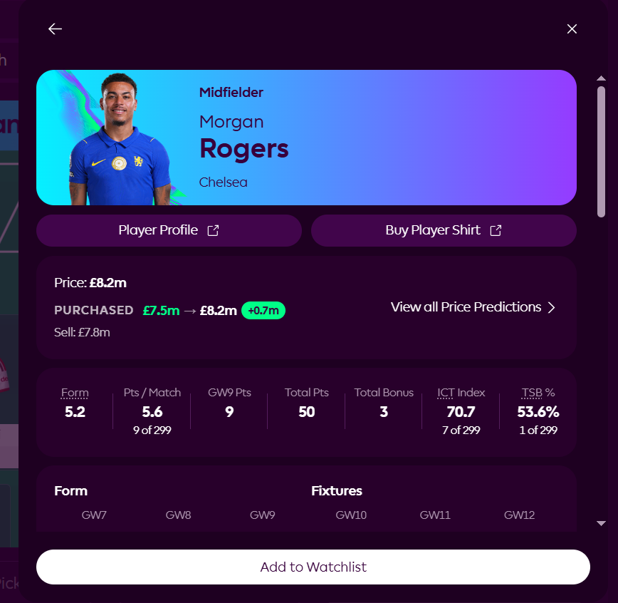

# FPL Purchase Price Info ⚽

A lightweight Chrome/Brave Extension for **Fantasy Premier League (FPL)** that automatically displays essential squad financial stats directly on player information profiles.

---

## 🌟 Features

- **Official FPL API Integration:** Zero third-party dependencies. Fetches data directly using your authenticated session.
- **Purchase & Selling Prices:** Clearly see your original purchase price and current selling price for every squad player.
- **Profit / Loss Indicator:** Automatically calculates the difference with colored badges (green for profit, red for loss).
- **Official Price Change Projections:** Shows **Predicted Progress** right next to the price using official Premier League SVG indicators (up 🟢 / down 🔴).
- **Seamless SPA Navigation:** Works persistently across player sheets, the "Full Profile" view, and pitch/list tabs.
- **Zero Configuration:** Automatically detects your Team Entry ID without prompting for any manual input.

---

## 📂 Project Structure

```text
├── manifest.json       # Extension Manifest V3 configuration
├── page-bridge.js      # MAIN world bridge (accesses FPL session & React state)
├── content.js          # Core logic (DOM observation, price injection)
├── styles.css          # Injected UI styling (matches official FPL design)
├── popup.html          # Clean extension popup status
├── popup.css           # Styling for popup interface
├── icon16.png          # App icon 16x16
├── icon48.png          # App icon 48x48
└── icon128.png         # App icon 128x128
```

---

## 🚀 Installation & Usage

1. Open your browser's extensions page (`brave://extensions/` or `chrome://extensions/`).
2. Enable **Developer mode** in the top right corner.
3. Click **Load unpacked** and select the extension folder.
4. Open [Fantasy Premier League](https://fantasy.premierleague.com/) and make sure you are logged in.
5. Click on the info icon `(i)` for any player in your squad to view their purchase price, sell price, profit/loss, and predicted price progress!
